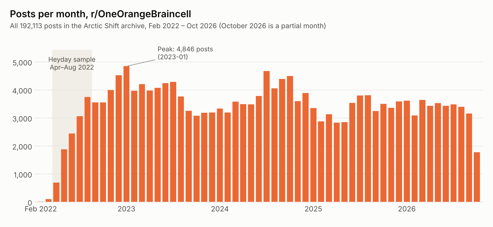
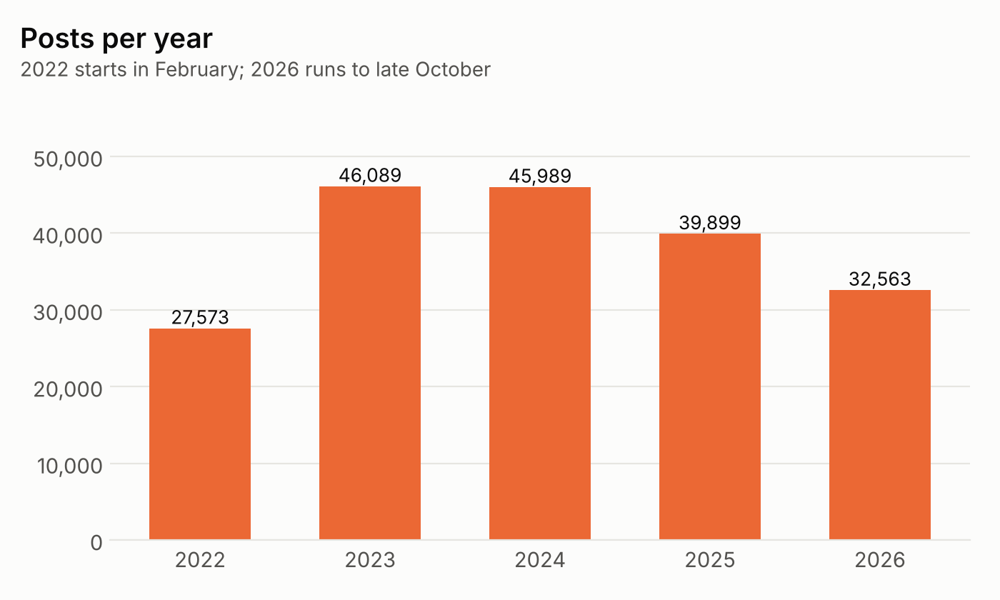
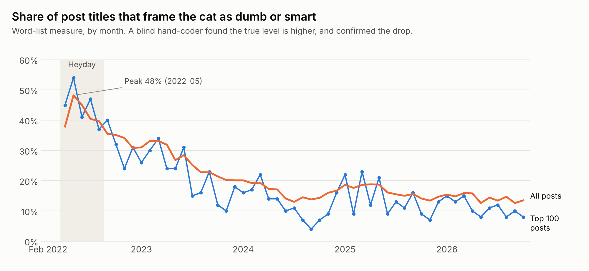
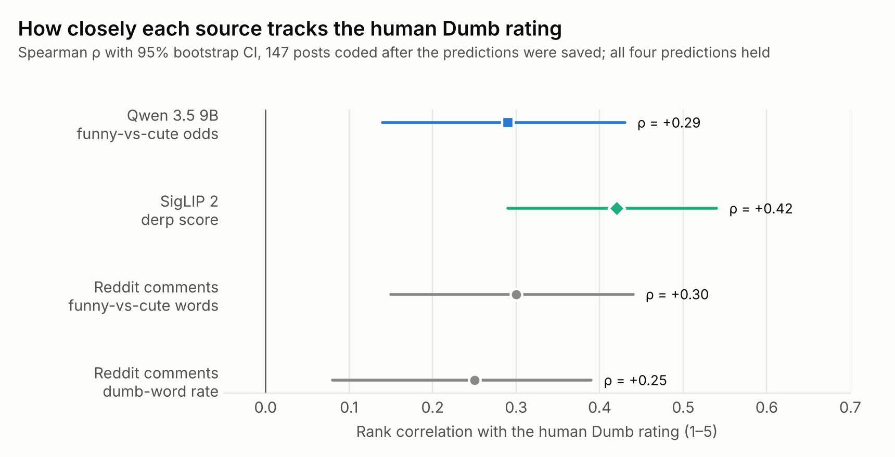
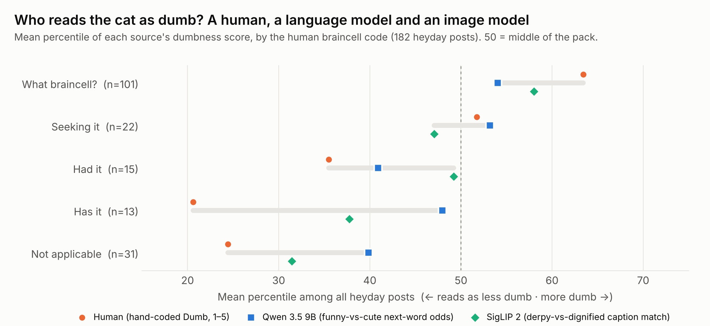

# One Orange Braincell: typical cats and the tails of the distribution

A small private research and visualization project about [r/OneOrangeBraincell](https://www.reddit.com/r/OneOrangeBraincell/), the subreddit built on the joke that all orange cats share a single brain cell. It asks two questions:

1. **Did the subreddit drift away from its own joke?** As it grew, did posts stop being about a cat that is very dumb (or, now and then, very smart)? If so, when was the joke at its peak?
2. **What does the typical "head empty, zero thoughts" cat look like?** If you code the peak-era posts by their braincell status, what does the typical cat in each group look like, and how do its posts behave?

The result is an interactive D3 page of "typical cats". Each cat's body shows what its group of cats looks like, and its tail carries the group's post data. It's a literal take on *the tails of the distribution*.

**Demo** available <a href="https://oneorangebraincell.web.app/">here</a>

---

## 1. The whole history, and why the sample is from 2022

### Getting the posts

Reddit's own API was closed to this kind of use, so every post comes from **[Arctic Shift](https://arctic-shift.photon-reddit.com/)**, an archive of public Reddit data. The first pulls were exploratory: the top posts of the last 30 days (`oobc_top_30days.csv`), the top 40 of the last six months (`oobc_6mo_top40.csv`), and a rank 50–80 test set. They were enough to set up the image model, but recent posts can't show whether anything changed. So the full history was downloaded: **192,113 posts, from the subreddit's first post in February 2022 to October 2026**.

Posting rose about sixfold through 2022, peaked at **4,846 posts in January 2023**, and has stayed between about 3,000 and 4,500 a month since. The shaded band is the window this project samples from.

### Finding the heyday

To find when the joke was strongest, each month was scored on how many titles **frame the cat through its wits**, as dumb or as smart, using a word list of braincell, dumb and smart terms (`oobc_ecology.py`). The same score was computed for the month's top 100 posts.

- **Peak:** in May 2022, 48% of all titles framed the cat as dumb or smart. Averaged over the three months around June it was about 45%, and among the top 100 posts it reached 54%.
- **Decline:** the share fell to 27% across 2023 and 16% in 2024, and has held at about 14% since. Among top posts it's now about 10%.
- **Growth isn't the whole story:** the decline began during the growth spurt, but framing kept falling for another 18 months after posting volume levelled off.
- **Top posts flipped:** in 2022, top posts were framed about as often as everything else. Now they're framed *less* than average, which fits the idea that a bigger crowd rewards plain cute-cat posts.

**Blind check.** A word list is a blunt tool, so a separate coder hand-coded 120 shuffled top-post titles without knowing which year they came from (60 from May–Jul 2022, 60 from Jun–Aug 2025):

| Measure | May–Jul 2022 | Jun–Aug 2025 |
| --- | --- | --- |
| Hand-coded: frames cat as dumb or smart | 63% | 18% |
| Word list: frames cat as dumb or smart | 48% | 8% |
| Agreement, hand vs word list (both eras) | 88% | κ = 0.73 |

The word list never flagged a title the hand-coder disagreed with, but it missed about a third of the framed ones. So the levels in the chart are underestimates, and the drop is real.

Two side checks: **flair** fell from about 50% dumb-or-smart flairs to about 35% by the end of 2022 and then barely moved, so people kept choosing braincell flairs but stopped writing the joke into their titles. In **top comments**, braincell talk fell from 18% to about 5%, and GIF- or image-only comments rose from 0% to 14–19%. Sexual-joke words stayed under 1% in every period, so that part of the original hypothesis didn't hold up.

### Choosing the sample: top 40 a month, April–August 2022

**April–August 2022** is the run where the framed share stays at or near 40% or higher: 38% in April, 48% in May, then 45%, 40% and 40%. It falls to 35% in September. (May–July is the core peak if a tighter window is ever needed.)

Within that window, posts were taken as the **top 40 per month** rather than the top 200 overall. The subreddit grew about fivefold over those five months, so an overall top list would have been mostly July and August posts, simply because more people were voting. The score needed to make a month's top 40 rose from 699 in April to 4,929 in August, so ranking within each month is the fair comparison.

That gives **200 posts** (`oobc_heyday_2022-04_08_top40.csv`). From them:

- 13 had dead media (deleted by their posters) and were dropped;
- 5 were memorial posts (the cat had died), listed in `oobc_archive/memorial_posts.csv` and excluded everywhere;
- **182 posts remain**, all hand-coded. Bread (`wqtzrl`, a cat that looks like a loaf) is kept, with its own model rerun in `oobc_archive/bread_rerun/`.

---

## 2. Coding the posts

### Hand codes (human)

Flair often doesn't match what's in the post, so every post was coded by hand from the media and the title. The master copy is Sheet5 of the Google Sheet *Orange Braincell Data*. A frozen, checksummed copy is `oobc_archive/final_codes/final_codes_2026-10-27.csv`.

| Code | Values |
| --- | --- |
| Braincell possession | What braincell? · Seeking it · Had it · Has it · Not applicable |
| Failure mode | Self · Physical · Object · Social · Other (NA when braincell is Not applicable; Has it keeps one) |
| Status inferred by | Actions · Expression · Both · Post context |
| Kin? | Cat called son, boy, baby, child, kid, or poster as parent (not "he/she" or a name) |
| Voiced? | Words put in the cat's mouth |
| Cuteness | 1–5 |
| Dumb | 1–5 |

The human Cuteness and Dumb ratings turned out to be almost independent (ρ = 0.06): a cat can be adorable *and* empty-headed.

### Cat traits (Qwen)

`oobc_cat_traits.py` sends each post's images (all gallery images, or frames sampled from a video) to **qwen3.5:9b** running locally in Ollama on a 12 GB card, with a JSON schema the reply must follow. For each cat it records % orange, white and other fur, main colour, age class, body condition, a rough weight, coat pattern, and where the white is. The model describes its visual cues *before* each label, and it is told not to assume a cat is orange. Its replies and a review page sit beside each CSV (`*_cats.csv`, `*_cats_raw.jsonl`, `*_cats_review.html`). These traits draw the bodies of the typical cats.

### Three readings of the same cat

To set "what the human coder thinks" against "what a computer trained on the internet thinks" and "what the internet thinks", each post also got:

- **Qwen 3.5 (9B), language model + vision.** It is shown the post's photos with its reply already started ("This cat is so…" / "What a…"), and the measure is how much of its next-word probability goes to *funny* words versus *cute* words (`oobc_archive/ai_opinion/tokenprobs/`).
- **SigLIP 2, image–caption matcher.** It scores each image against pairs of opposite captions (dumb/smart, cute/ugly, fat/skinny, derpy/dignified, blank/thinking, loaf/cat) (`oobc_archive/ai_opinion/siglip_scores.csv`).
- **Reddit comments, the internet.** Word rates in each post's comments: funny versus cute words, and dumb words, including "orange" used to mean dumb (`oobc_archive/comment_analysis/`).

The predictions were saved **before** the remaining 147 posts were hand-coded (`oobc_archive/ai_opinion/stage2_predictions.md`) and then tested once (`oobc_archive/final_codes/stage2_results.md`): one-sided Spearman, bootstrap CIs, Holm correction. **Four of five held.**

The fifth prediction, that the trait model would reason for less time about cuter cats, didn't hold up (ρ = −0.06) and was dropped.

### Where the readings agree and where they don't

The scores are on different scales, so the chart below puts each one on the same footing: its **percentile among all 182 posts** (50 = middle of the pack), averaged within each of the human braincell groups.

- **All three agree on the order at the ends.** "What braincell?" cats read as dumbest to everyone, and "Not applicable" cats (plain cute-cat posts) read as least dumb.
- **The human ratings spread the groups much further apart.** Human group means run from about the 21st to the 64th percentile, while Qwen's stay between about 40 and 54. The human coder is coding the *post*: title, caption and context. The models only see the picture.
- **"Has it" is where the models miss most.** The human coder rates cats that still have the braincell as the least dumb of all, at about the 21st percentile. Qwen puts them near the middle (48th): a cat doing something clever in a photo still looks funny rather than cute to it. SigLIP lands between the two (38th).
- **SigLIP tracks the human ratings more closely than Qwen does** overall (ρ = 0.42 vs 0.29 with the human Dumb rating). "Derpy versus dignified" is apparently close to what the human coder means by dumb. But SigLIP rates "Had it" cats (the brain cell has just left the building) as average.

These three-source measures are **held out of the main visualization's claims** for now; there is a separate plan for presenting them. The D3 page does show Qwen's and SigLIP's readings of any group behind its robot button.

---

## 3. The visualization: typical cats

`viz_d3/` holds the current version (see `viz_d3/README.md`). Double-click `Open viz.bat`, or run `python viz_d3/serve.py`, then open the page it prints.

- **One cat per group** of the chosen category (for example braincell possession), all drawn at one scale from the cat kit in `SVG/cat_kit.svg`.
- **Body and coat:** the group's median share of white fur, plus white markings and a body type that are over-represented in the group (≥1.3× as common as overall and on ≥30% of its cats; 3 cats minimum).
- **Eyes:** wide and wonky for the dumbest group in the view, big and sparkly for the cutest of the others, and a fixed random set for the rest.
- **Tail segments:** upvotes and comments by default, each its own shade from white to orange to brown. A segment's length is where the group's median sits among all posts.
- **Tail stripes:** one per hand code, showing the group's standout value on that code, as thick as that value's share of the group.
- **Click a cat** to zoom to its tail. Click a segment or stripe for its distribution and posts, then **Chase this tail**: the cat pounces on its own tail and the row regroups into left tail (<p10), body and right tail (>p90).

Heyday cut points for those tails: upvotes p10 1,095 / p50 3,866 / p90 7,138; comments p10 20 / p50 64 / p90 154.

The earlier single-file prototype is `viz/oobc_cat_viz.html` (rebuild with `python oobc_archive/viz/build_viz_data.py`, then `python viz/build_viz.py`).

**Left out of this version:** the decline-over-time story from section 1, and the three-source comparison from section 2.

---

## Folder map

| Path | What it is |
| --- | --- |
| `oobc_heyday_2022-04_08_top40.csv` | The 200 heyday posts with media links and media status |
| `oobc_heyday_2022-04_08_top40_cats.csv` / `_raw.jsonl` | Qwen cat traits per cat, and its raw replies |
| `Orange Braincell Data - InProgress.csv` | Local copy of the hand codes, synced to Sheet5 (182 rows) |
| `oobc_cat_traits.py` | Cat-trait extraction with a local vision model (Ollama) |
| `oobc_archive/final_codes/` | Frozen codes, the stage 2 test script and results |
| `oobc_archive/ai_opinion/` | SigLIP scores, Qwen token probabilities, reasoning measures, the saved predictions |
| `oobc_archive/comment_analysis/` | Comment word lists and per-post rates |
| `oobc_archive/comments/` | All saved comments, one JSON file per post |
| `oobc_archive/heyday_post_meta.csv` | 30 archive metadata columns per post (timing, percentiles, author, top comments) |
| `SVG/` | The cat kit: 4 bodies, 10 white zones, 7 eye sets, tails |
| `viz/` | Single-file prototype |
| `viz_d3/` | The D3 visualization |
| `docs/` | Current-state, D3 handoff and build-plan notes |
| `docs/readme/` | This README's charts, the script that draws them, and their input data |

## Open items

- [ ] Blind re-code of 40 posts for inter-rater reliability (κ)
- [ ] A way to present the three rating sources (computer, internet, human)
- [ ] Mix segments always sum to 100%, so they add the same length to every tail; consider a fixed-width band at the tip
- [ ] Code the 6-month sets the same way, if the decline story comes back

---

*Data: Arctic Shift archive of public Reddit posts. Models: qwen3.5:9b (Ollama, local) and SigLIP 2. Hand coding by a human coder.*
