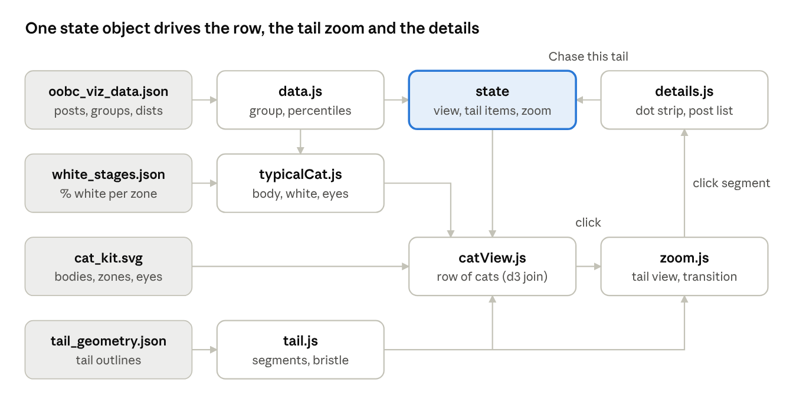

# Typical Orange Cats — D3 rebuild handoff

Nov 1, 2026 · @AC

## Goal and scope

Rebuild the prototype (`viz/oobc_cat_viz.html`) as a native HTML/JS page that does the same things, using D3 wherever D3 has the tool. It reads a JSON data file and the cat kit SVG rather than having them pasted in by a Python build step. Read the [current state doc](https://claude.ai/artifact/QuRy64Wkd4ZZHAEkTwbTmr) first for decisions and file locations.

**In scope:** the one-row view of typical cats, category switching, "Tails of" regrouping, the zoom to a tail, segment details with the dot strip, Chase this tail, the settings panel, light and dark themes, phone width.

**Out of scope for this version:** the decline-over-time story, the three rating sources (SigLIP, language model, comments), and new data work. The pounce transition is a stretch goal once the rest works.

## Inputs

The page needs one data file and three kit assets, all already on AC's machine. Serve the folder over a local server (`python -m http.server`), since `d3.json` and `d3.xml` can't load from `file://`.

**Data:** `oobc_archive/viz/oobc_viz_data.json` (about 280 KB), built by `build_viz_data.py`.

| Key | Shape | Notes |
| --- | --- | --- |
| `meta` | `{built, n_posts, set, typical_cat_rule}` | 182 posts |
| `groupings` | `{key: {label, values[]}}` | braincell, failure, inferred, anthro, dumb, cute; `values` in display order |
| `tailvars` | `{key: {label, source, dist}}` | source = post, ac or look; `dist` = n, p10, p50, p90, min, max, kind (lognormal adds mu, sd) |
| `posts[]` | `{id, month, rank, title, groups, vals, tails, traits}` | `groups` = value per grouping; `vals` = value per tail var; `tails` = left, body or right per tail var |
| `posts[].traits` | `{body, kg, pct_white, pct_orange, coat, stripes, zones[], cat_count}` | `pct_white` null = no cat traits (Bread has a rerun) |
| `groups` | precomputed typical cats per grouping value | for checking only; the page computes groups itself |

**Kit assets:**

| File | Holds |
| --- | --- |
| `SVG/cat_kit.svg` | viewBox `-4 -10 320 500`; four `g.body[data-body]` (typical, kitten, slender, chunky); white zones `.w-zone.w-<zone>`; seven `g.eyes[data-set]`; CSS that switches them from `data-body`, `data-white`, `data-eyes`, `data-stripes` on the root |
| `SVG/white_stages.json` | `white_pct_cumulative[body]`: % white after 0–10 zones, in zone order chin, locket, muzzle, bib, blaze, belly, paws, stockings, face, body |
| `SVG/tails/tail_geometry.json` | per tail (long, short): `stroke` (outline points) and `stations` (index pairs into the stroke for each edge at a fraction along the tail) |

## Architecture

Every control writes to one `state` object (arrangement, tail items, mix, zoomed cat, selected segment), and the views re-render from it. Chase this tail is the loop: details writes a new arrangement to state and the row redraws.

## Behaviour spec

Carry these rules over exactly; they are AC's decisions, and the prototype's `viz/viz_template.html` is the reference implementation.

**Views**

1. **Row view (default).** Header = "r/OneOrangeBraincell" in small mono, then the category name as a large heading that is also the switcher. One centred row of cats, one per group value, max about 250 px each, all drawn at one shared scale, with a plain label under each. No other text on the page. A sliders icon opens the settings panel.
2. **Tail view.** Clicking a cat or any tail segment zooms to that cat's tail: the body fades out, the frame animates (about 650 ms, ease-out cubic) to fit just the tail and its labels, and segments are labelled "Name value". A back button and Esc return to the row. Clicking a segment from the row opens the tail view with that segment selected.
3. **Segment details**, under the zoomed tail: the measure name, the group median and its percentile among all posts (and whether that's in the left tail, body or right tail), a dot strip of all posts with this group's posts highlighted and the outer 10% shaded, a collapsible list of the group's post titles, and **Chase this tail**. For a mix segment: the group's share against the share among all posts.
4. **Chase this tail.** For a tail variable, regroups all posts into left tail (below p10), body and right tail (above p90), each with its own typical cat; the heading becomes "Tails of \<variable>". For a mix segment, it switches the arrangement to that category.

**Typical cat for a group** (computed in the page)

- Ignore posts whose `traits.pct_white` is null.
- White amount: the group's median `pct_white`; turn on zones in order until the cumulative % (from `white_stages.json`, for the chosen body) is closest to that median.
- Extra zones: a zone ≥1.3× as common as across all posts and present on ≥30% of the group.
- Body: kitten, slender or chunky only if ≥1.5× as common and ≥25% of the group; else typical.
- A trait needs at least 3 cats in the group to count. Stripes on if most of the group has them.
- Groups under 10 cats are small; treat them loosely.

**Eyes:** big-shiny for the group with the highest mean Cuteness and the group with the highest mean Dumb in the current view; every other cat gets one of the other six sets, chosen by a stable hash of arrangement + group value.

**Tail encoding**

- Items, base to tip: the chosen tail variables (default upvotes, comments), then one segment per value of the chosen mix category (default failure mode).
- Each item has its own fixed shade from a white → orange → brown ramp (stops `#FFF7EE #F8D2A2 #EDA35A #D9782C #A7531D #5E2C0E`, interpolated in OKLab), the same on every cat.
- Segment length: for a variable, the percentile of the group median among all posts (rank inverted, so nearer the top = longer); for a mix value, its share of the group.
- Tail length = sum of segment lengths, scaled so the longest tail in the view fills the full drawn tail; minimum 0.3 of the tail.
- Hover or select a segment: it bristles, with spikes pointing outward from the band.

**Cat drawing:** rotate each body 5° clockwise around the middle of its base (tail included). Tail size 1.6× life-size.

## Where D3 replaces the prototype's code

Most of the prototype's hand-rolled helpers have a D3 equivalent; the tail geometry and the kit's CSS switches don't, and should be ported as they are.

| Prototype code | D3 replacement |
| --- | --- |
| Data pasted into the page by `build_viz.py` | `Promise.all([d3.json(data), d3.xml(kit), d3.json(stages), d3.json(tailGeom)])` |
| `median`, `mean`, percentile rank | `d3.median`, `d3.mean`, `d3.bisectLeft` on a sorted array for rank; `d3.quantile` for p10/p90 |
| Grouping posts with `filter` per value | `d3.group(posts, p => p.groups[key])`, ordered by `groupings[key].values` |
| OKLab ramp written by hand | `d3.interpolateLab` or `d3.piecewise(d3.interpolateLab, STOPS)` (CIELAB, close enough; or keep the OKLab code if the shades must match exactly) |
| Building cat cards with `createElement` | `d3.select('#row').selectAll('.cat').data(cats, d => d.value).join(...)`, so switching category enters, updates and exits cats |
| viewBox animation with `requestAnimationFrame` | `d3.transition().duration(650).ease(d3.easeCubicOut).attrTween('viewBox', ...)` with `d3.interpolate` over the four numbers |
| Dot strip drawn as string SVG | `d3.scaleLog` (lognormal vars) or `d3.scaleLinear`, `d3.axisBottom` for ticks, a join of circles; jitter from a seeded hash, as now |
| Tail band paths built as strings | `d3.line()` over the band's points (`curveLinear` to keep the drawn edge); the bristle morph as a d3 transition on `d` |
| Click and keyboard handlers | `selection.on('click', ...)`; keep the `tabindex`, `role='button'` and Enter/Space handling for the segments |
| Seeded eye pick (FNV hash) | Keep as is; D3 has no seeded hash |

**Port as is:** the tail module's geometry (`prep`, `band`, `bandShapes`, `placement` in `viz/cat_tail_viz_template.js`), which places the drawn tail on each body using `ATTACH` points per body, and the kit's CSS attribute switches. Load the kit once with `d3.xml`, then clone its root node for each cat.

## Build steps

Build in this order and check each step before the next; keep the prototype open beside the new page to compare.

1. **Project skeleton.** A new folder `viz_d3/` with `index.html`, `main.js`, `style.css` and ES modules (`data.js`, `typicalCat.js`, `tail.js`, `catView.js`, `zoom.js`, `details.js`). Load D3 v7 from a pinned CDN URL (e.g. `d3@7.9.0`), or a local copy. *Check:* the page loads all four inputs over `http.server` with no console errors.
2. **Data layer.** Index posts, group them, compute distributions and percentiles. *Check:* for every hand-code group, n matches `oobc_viz_data.json` `groups`.
3. **Typical cat.** Port the rule from the spec. *Check:* body, median % white and extra zones match the precomputed `groups[...].cat` for all 29 hand-code groups (the prototype passed this check).
4. **One static cat.** Clone the kit, set the data attributes, rotate 5°. *Check:* it looks like the prototype's cat for the same group.
5. **Tail module.** Port the geometry, then draw segments with weights and fills; bristle outward. *Check:* segment boundaries at the same fractions as the prototype; spikes never cut into the band.
6. **Row view with joins.** One cat per group, shared viewBox, category switcher, settings panel. *Check:* switching category keeps scales equal; eyes follow the rule.
7. **Tail view.** Zoom transition, fade, labels at a readable size, back and Esc. *Check:* the tail fills the frame on desktop and at 390 px wide.
8. **Details and Chase this tail.** Dot strip with D3 scales and axis, post list, regrouping. *Check:* chasing upvotes gives left / body / right groups of 19 / 144 / 19 posts.
9. **Polish.** Light and dark tokens, keyboard focus, reduced motion, no horizontal scroll at phone width.
10. **Stretch: pounce.** The cat chases its tail when Chase this tail is pressed.

A rebuild script can still produce a single self-contained file at the end, if AC wants one to open without a server.

## Gotchas from the prototype

These each cost a round of fixes in the prototype.

- **The kit root is an id.** `cat_kit.svg` uses `id="cat"` and its CSS targets `#cat[...]`. With several cats on a page, swap the id for a class (`.cat-kit`) and rewrite the selectors, as `build_viz.py` does.
- **Measure only visible SVG.** `getBBox` and screen matrices return zeros for hidden elements. Show the row before re-measuring (the prototype's `refresh` unhides it first).
- **Measure through transforms.** The 5° rotation means `getBBox` on the body is in unrotated units. Use screen-space corners mapped back by the inverse screen matrix (the prototype's `boxOf`).
- **Labels shrink when zoomed out.** Tail labels are in kit units, so set their font size from the zoomed scale (14 px divided by the scale), and re-measure after, since the labels change the box.
- **Bristle direction.** Compute "outward" per edge as away from the facing point on the opposite edge, not from the ring's winding, or spikes cut into the band.
- **Mix segments always total 100%.** They add the same length to every tail, which flattens the differences in the variable segments. Open question for AC: a fixed-width band at the tip instead.
- **`[hidden]` vs `display: grid`.** Any element styled with `display` needs `[hidden] { display: none }` or it stays visible.
- **Fonts.** The page uses Google Fonts (Bricolage Grotesque, IBM Plex Sans and Mono); offline it falls back to system fonts. Size the heading switcher after `document.fonts.ready`.
- **The weight slip.** One post (`v232cr`) had 4,500 kg for 4.5 kg; the data builder divides values over 20 by 1,000. Keep that guard if traits are rebuilt.
