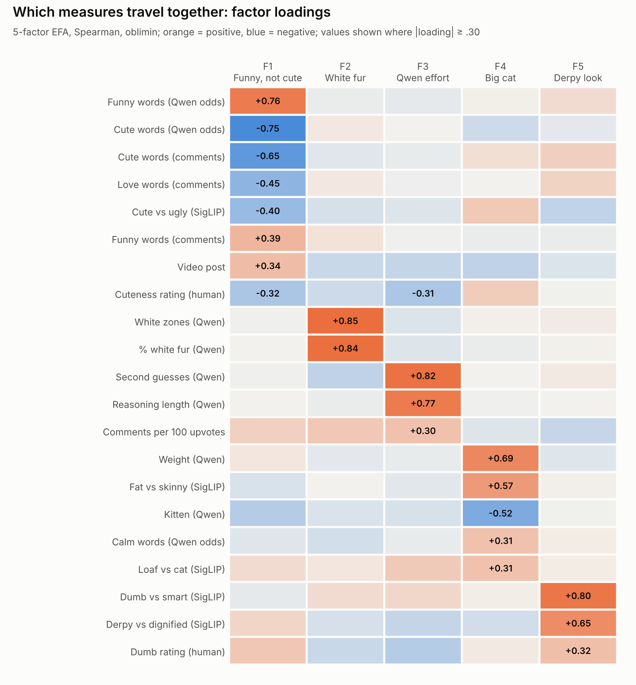
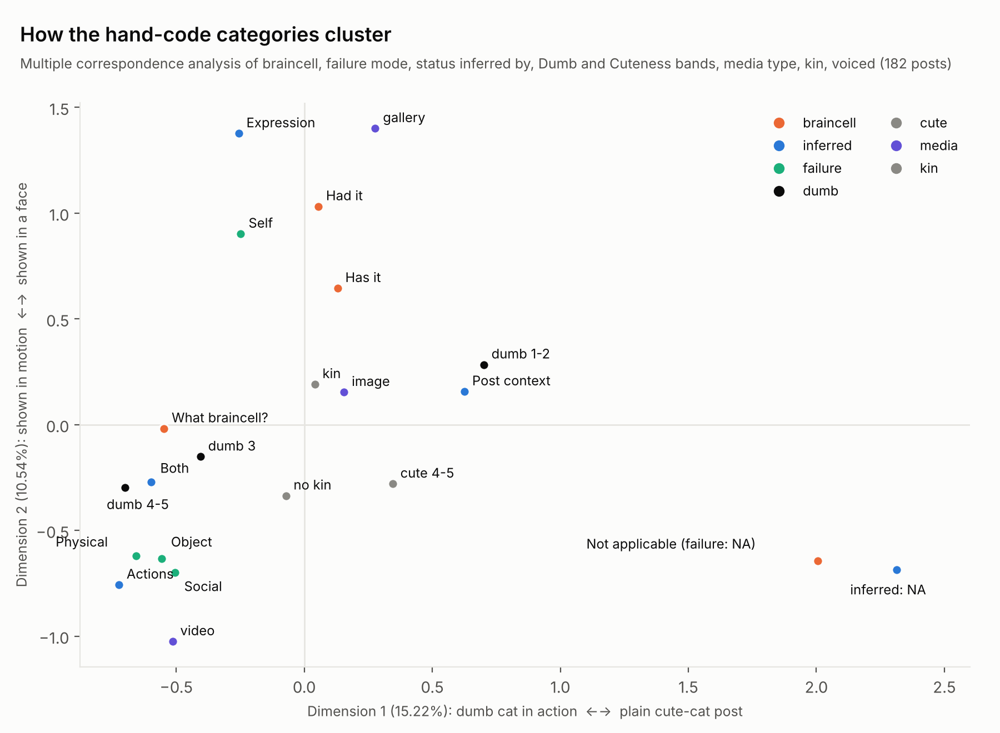
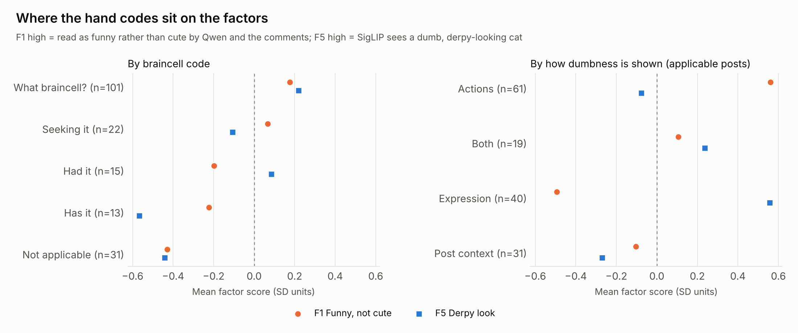

# What travels together? An exploratory structure analysis

An exploratory look at which hand codes, cat traits, model readings, comment measures and post statistics move together across the 182 heyday posts. Nothing here was predicted in advance, so every pattern is a hypothesis to test on new posts, not a finding.

**Rerun:** `python oobc_archive/exploratory/explore_structure.py` from the Orange_Braincells folder. It needs `pip install statsmodels factor_analyzer prince`. It takes about 2 minutes and rewrites everything in this folder. All the numbers below come from `results.md`.

## What was run

1. **Factor analysis** of 32 numeric and yes/no measures: the human Dumb, Cuteness, Kin and Voiced codes; Qwen's cat traits, word odds and reasoning; SigLIP's six caption scores; ten comment word rates; and post statistics. It uses Spearman correlations, because many measures are skewed. Parallel analysis set the number of factors, and the solution uses minres extraction with oblimin rotation. A bootstrap (200 resamples) checked whether each factor replicates.
2. **Categorical codes:** Cramér's V for every pair among braincell, failure mode, status inferred by, the Dumb and Cuteness bands, media type, kin, voiced, white fur, kitten and month, with permutation p-values and Benjamini-Hochberg correction. The test was then repeated on the 151 posts where every code applies. That drops pairs the coding rules force, such as Not applicable always getting NA for failure mode. A multiple correspondence analysis (MCA) maps the categories.
3. **Multilevel check:** posts are nested in months. A random-intercept model per measure gives the share of variance between months (ICC). A mixed model of the human Dumb rating asks whether the outside sources carry separate information about it.

## Results

### 1. Five groups of measures that move together

Parallel analysis allowed up to eight factors, but only five replicate in the bootstrap. Their median congruence is .83–.95; a sixth factor fell to .69. The measures are only loosely related overall (KMO = .54), so each factor explains a modest share of variance.

| Factor | What loads on it | Reading |
| --- | --- | --- |
| **F1 Funny, not cute** | Qwen funny odds +.76 and cute odds −.75; comment cute −.65, love −.45 and funny +.39 words; SigLIP cute −.40; video +.34; human Cuteness −.32 | **The computer and the internet agree here.** Qwen's next-word odds and the commenters' word choice line up on one cute-to-funny axis. Videos sit at the funny end. |
| **F2 White fur** | Qwen % white +.84, white zones +.85 | Two readings of the same trait. |
| **F3 Qwen effort** | Qwen second guesses +.82, reasoning length +.77; human Cuteness −.31; comments per upvote +.30 | Qwen works harder on less cute cats, *but* this exact link failed its pre-registered test (prediction 3, ρ = −.06). Treat it as noise until shown otherwise. |
| **F4 Big cat** | Qwen weight +.69, SigLIP fat +.57, kitten −.52, Qwen calm odds +.31, SigLIP loaf +.31 | Size and loafiness, read by two different models. |
| **F5 Derpy look** | SigLIP dumb +.80 and derp +.65; human Dumb +.32 | What a dumb cat *looks like* to an image model. |

**The human Dumb rating doesn't belong to one factor.** It splits across F5 Derpy look (+.32), F1 Funny (+.28) and F3 (−.28). So "dumb" as a human codes it combines a look with a situation.

**Measures that travel with nothing:** Kin, Voiced, the comment braincell, dumb, kin, body and smart word rates, upvote percentile, crossposts, and more than one cat. Two of these matter most:
- **Popularity doesn't line up with any other measure.** Within each month's top 40, how dumb or cute a cat is says nothing about where it ranks.
- **The comment *braincell* and *dumb* rates don't sit with the funny/cute axis.** Commenters joking about the braincell is a separate habit from finding the cat funny.

### 2. Two routes to a dumb cat

Some of the strongest pairs are artifacts of the coding rules. Braincell × failure mode is V = .52 on all posts but falls to .18 (not significant) once the NA-by-rule cells are removed. **Failure mode is largely independent of braincell status.** On the 151 applicable posts, these pairs survive correction:

| Pair | V | What drives it |
| --- | --- | --- |
| Status inferred by × media | .42 | Actions ↔ video; Expression ↔ galleries (only 1 of 40 is a video); Post context ↔ single images |
| Failure mode × inferred by | .36 | Self ↔ Expression (38 of 40 Expression posts are Self failures); Object and Social failures never read from a face |
| Braincell × Dumb band | .32 | What braincell? ↔ Dumb 4–5; Has it ↔ Dumb 1–2 |
| Dumb band × media | .30 | Dumb 4–5 ↔ video; Dumb 1–2 ↔ galleries |
| Failure mode × media | .28 | Self ↔ galleries; Social ↔ video |
| Inferred by × Dumb band | .26 | Post context ↔ Dumb 1–2: when the title does the work, the cat is rated less dumb |

The MCA map shows the same thing as three clusters:

- **Dumb in action:** video, status read from actions, Physical, Object and Social failures, Dumb 4–5, What braincell?. A cat *doing* something dumb.
- **Dumb in the face:** galleries, status read from expression, Self failures, and Had it / Has it. A cat that *looks* empty, often across several photos.
- **Dumb by caption:** single images, status read from post context, Dumb 1–2. The title turns an ordinary photo into a braincell post.

Not applicable posts (plain cute cats) sit far off on their own.

**The human Cuteness rating has no link to any categorical code.** Cuteness is independent of how dumbness is shown.

### 3. The factors see the two routes differently

| Status inferred by | F1 Funny, not cute | F5 Derpy look |
| --- | --- | --- |
| Actions (n = 61) | **+0.56** | −0.08 |
| Both (n = 19) | +0.11 | +0.24 |
| Expression (n = 40) | **−0.49** | **+0.56** |
| Post context (n = 31) | −0.10 | −0.27 |

(SD units. Kruskal-Wallis ε² = .19 for F1 and .08 for F5, both p < .01.)

**The outside sources each catch one route.** When dumbness shows in actions, Qwen and the commenters call the cat funny, and SigLIP sees nothing unusual. When it shows in the face, SigLIP calls the cat derpy, while Qwen and the commenters call it *cute*. By failure mode the pattern repeats: Physical failures are the funniest (F1 +0.71), and Self failures look the derpiest (F5 +0.36). By braincell, "Has it" cats look the least derpy of all (F5 −0.57), even lower than plain cute cats.

This lines up with the multilevel model below. SigLIP and the comments each add their own information about the human Dumb rating because they see different routes. Qwen adds nothing beyond the comments, because it reads the same route they do.

### 4. Nothing varies by month

Month ICCs are 0–3% for every measure, and no measure trends across April–August (all |ρ| ≤ .11, p ≥ .16). The heyday window is homogeneous, so a single-level analysis is appropriate here. Only five authors posted more than once (12 posts), which is too few to model authors as a level. A multilevel model would earn its place across eras (2022 vs 2025), where the decline story lives, not within the heyday.

Human Dumb rating regressed on the three outside sources together (standardized, random intercept for month, n = 180):

| Predictor | b | 95% CI |
| --- | --- | --- |
| SigLIP derp | **+0.43** | [+0.27, +0.59] |
| Comments funny-vs-cute | **+0.19** | [+0.03, +0.35] |
| Qwen funny-vs-cute | +0.10 | [−0.07, +0.28] |

### Weaker hints, worth a look but not trusted

- **Voiced posts score high on Big cat** (F4 +0.67, p = .003, n = 16). Cats given words to say may skew big and loafy.
- **Kin posts score higher on White fur and Big cat** than posts without kin language. Part of this may be a media effect: videos get lower white-fur and weight readings (F2 −0.34, F4 −0.45), probably because Qwen sees less from sampled frames, and posts without kin language are more often videos.
- **What braincell? may be less common among white-heavy cats** (braincell × white fur, V = .25, q = .14, not significant).

## Caveats

- **Exploratory and small:** 182 posts, 32 measures, many tests. Correlations are mostly weak (KMO .54). Hold every pattern until it replicates.
- **Media is a confound.** Qwen's traits and reasoning come from sampled frames for videos, and video is tied to the action route, so some trait differences may be about the format, not the cat.
- **One coder.** The hand codes are a single coder's judgments; the planned blind re-code of 40 posts would put a reliability figure on them.
- **Rule-forced pairs.** Pairs that involve the NA levels are partly built in by the coding rules. That's why the applicable-only column is the one to read.

## For the visualization

The two routes give a natural way to present the three rating sources. SigLIP speaks for the face, Qwen and the comments speak for the action, and the human ratings span both. A tail stripe or a side-by-side could show which route a group's cats take, using status inferred by, and which source agrees with the human ratings for that group.

## Files

| File | What it is |
| --- | --- |
| `explore_structure.py` | The whole analysis: tables, CSVs and figures |
| `build_table.py` | Builds `posts.csv`, one row per post with 56 variables from the project's existing files (run automatically if missing) |
| `results.md` | Every table this write-up draws on |
| `loadings.csv`, `factor_scores.csv` | Factor loadings with communalities, and each post's factor scores |
| `cramers_v.csv` | Every pair of categorical codes, all posts and applicable posts |
| `fig_*.png` | The three figures above |
